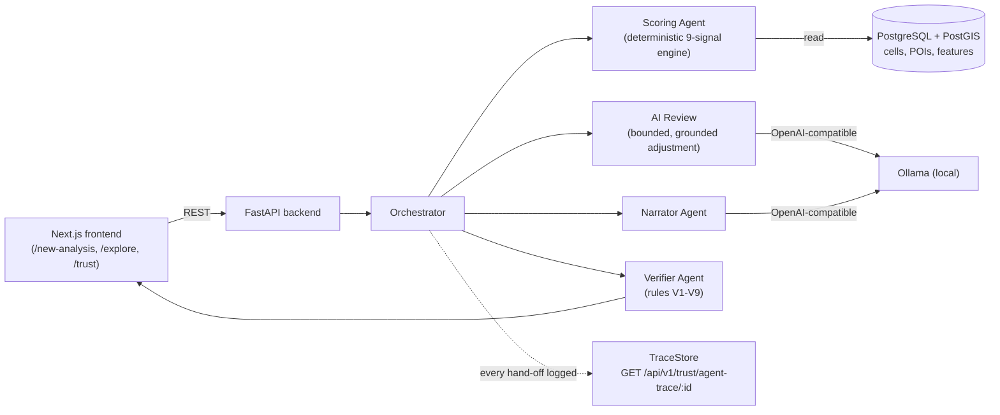

<h1 align="center">Disha AI (दिशा)</h1>

<p align="center">
  <b>Verifiable location intelligence for Bengaluru.</b><br />
  Pick a category and a budget tier — get every eligible zone in the city scored, ranked,
  and explained against real OpenStreetMap data, with no invented numbers.
</p>

<p align="center">
  <a href="LICENSE"></a>
  
  
  
  
  
</p>

<p align="center">
  <b>Hackathon submission</b> — Track 2, Best Open-Source AI Project<br />
  Problem statement O3 — Trustworthy and Verifiable AI<br />
  Repository: <a href="https://github.com/manya1106/DishaAI">github.com/manya1106/DishaAI</a>
</p>

---

## What it does

Store owners — cafés, pharmacies, gyms — usually pick a location on gut feeling, a broker's
word, or a generic AI chatbot that confidently invents plausible-sounding rent and footfall
numbers. **Disha AI** replaces that guess with a data-backed decision.

Walk through a short wizard (category → budget tier → who you serve → review) and it:

1. Scores **every eligible H3 hexagonal cell in Bengaluru** against 9 weighted signals —
   footfall anchors, competition density, residential catchment, transit access, and more —
   computed from real OpenStreetMap data sitting in PostGIS, not a static fixture.
2. Dispatches the request through a real **agent swarm** (Orchestrator → Scoring Agent → AI
   Review → Narrator Agent → Verifier Agent), with every hand-off logged and inspectable via
   `GET /api/v1/trust/agent-trace/{trace_id}` — so "the agents did the work" is something you
   can check, not just a claim on screen.
3. Ranks the top zones with a real evidence-grounded narrative: what's working, what to watch
   out for, and exactly which of your wizard answers nudged which signal's weight, by how much.
4. Lets you ask natural-language follow-up questions, answered by a local LLM (Ollama) with a
   **grounding guardrail (rules V1–V9)** — every claim is checked against the underlying data
   before it reaches you, and it refuses rather than guesses when it can't answer honestly.
5. Gives you a full trust and analytics view: a city-wide score distribution, a confidence-vs-
   score chart, a per-signal contribution matrix, and the raw agent trace for any analysis.

## Why it's real, not a demo shell

Every number on screen traces back to a live computation:

- **Real data, not a fixture.** 1,630 H3 resolution-8 cells (1,382 eligible) and 36,411 real
  POIs, ingested straight from OpenStreetMap into PostgreSQL + PostGIS by
  `scripts/ingest_osm_bengaluru.py` — verifiable down to matching real `osm_id`s. If Postgres
  is unreachable, the app falls back to a local JSON snapshot rather than failing silently.
- **Deterministic scoring is the single source of truth.** The 9-signal engine
  (`apps/api/app/scoring/engine.py`) is 100% reproducible — identical inputs always produce
  identical scores, bit-for-bit, enforced by a golden test. The AI never computes or invents a
  ranking.
- **An AI Review layer that's additive, bounded, and grounded — not a black box.** On top of
  the deterministic score, an independent LLM pass may nudge the top zones by at most ±5%, and
  only when its stated reason actually cites a real signal value from that zone's own evidence.
  An ungrounded, missing, or malformed reason reverts the zone to its pure math score. The math
  score and the AI's read on it are always shown separately, never conflated.
- **A real claim verifier, not a prompt wrapper.** Every LLM-generated sentence is decomposed
  into claims and checked against nine concrete rules (V1–V9) — unsupported numbers, unknown
  locations, and polarity contradictions are stripped out before anything reaches the user.
- **Honest about what it doesn't know.** Every metric carries an explicit provenance tag
  (`measured`, `estimated`, `heuristic`, `unavailable`) and the system refuses to fabricate
  private figures like exact rupee rents — it states a relative tier instead.

## Architecture



Every hand-off between agents is recorded with a shared `trace_id`, so a single request's
agent-to-agent sequence — not just the final answer — can be inspected.

## The Nine Location Signals

Scores are **relative percentiles (0–100)** across every eligible cell in the city grid:

| # | Signal ID | Raw input / proxy | Direction | Provenance |
|---|---|---|---|---|
| 1 | `competition_density` | Count of direct competitor POIs nearby | Lower is better | `measured` |
| 2 | `gap_opportunity` | Demand proxy (anchors + residential) ÷ (competitors + 1) | Higher is better | `estimated` |
| 3 | `footfall_anchors` | Proximity to malls, colleges, tech parks, markets, hospitals | Higher is better | `estimated` |
| 4 | `transit_access` | Bus stop and metro entrance accessibility | Higher is better | `measured` |
| 5 | `complementary_mix` | Count of category-synergetic commercial venues | Higher is better | `measured` |
| 6 | `residential_catchment` | Mapped apartment buildings and residential land use | Higher is better | `estimated` |
| 7 | `daytime_population` | Offices, commercial buildings, and college counts | Higher is better | `estimated` |
| 8 | `road_accessibility` | Primary/secondary road network length + junction count | Higher is better | `measured` |
| 9 | `rent_efficiency` | Heuristic rent tier (1–5) alignment with budget ceiling | Higher is better | `heuristic` |

## The V1–V9 Claim Verification Pipeline

Before any natural-language response reaches the user, it must pass nine code-level checks:

* **V1 — Schema validity:** output strictly matches the single-sentence block/claim schema.
* **V2 — Evidence citation:** every claim cites evidence IDs that exist in the active bundle.
* **V3 — Numeric consistency:** numbers in text must match cited values within tolerance.
* **V4 — Entity grounding:** locations and ranks mentioned must exist in the analysis set.
* **V5 — Rank & comparison validity:** recomputed deltas must match the claimed direction.
* **V6 — Polarity consistency:** strength claims require score ≥ 50; weakness claims ≤ 45.
* **V7 — Forbidden topics:** unsubstantiated currency, revenue, or profit figures are rejected.
* **V8 — Uncited numbers:** sentences with numbers but no backing claim are excised.
* **V9 — Integrity threshold:** if over half a response's statements fail, it degrades to the
  deterministic fallback narrator entirely.

## Tech stack

| Layer | Technology |
|---|---|
| Frontend | Next.js 16, React, Tailwind CSS, MapLibre GL |
| Backend | FastAPI, Pydantic v2, SQLAlchemy 2.0 (async) |
| Database | PostgreSQL + PostGIS, Alembic migrations |
| Agents | In-process orchestrator + typed agent message contracts |
| LLM | Ollama (local, OpenAI-compatible endpoint) — any hosted OpenAI-compatible provider also works |
| Data | OpenStreetMap, Uber H3 geospatial indexing |
| Infra | Docker Compose (PostGIS) |

## Project structure

```
apps/api/            FastAPI backend
  app/agents/           Orchestrator, Scoring/Narrator/Verifier agent wrappers, TraceStore
  app/ai/                LLM adapter, AI Review, evidence bundling, V1-V9 verifier, fallback narrator
  app/scoring/           Deterministic 9-signal engine, explain/compare logic, config YAMLs
  app/db/                SQLAlchemy models, async session
  app/routers/           /analyses, /chat, /meta, /trust, /health
  tests/                 Unit + integration test suite
apps/web/             Next.js frontend
  src/app/               /new-analysis (wizard), /explore (results + chat + trust matrix), /trust
  src/components/        Map, ranked list, location report, compare view, chat panel
  src/lib/, src/types/   Typed API client, generated OpenAPI types
contracts/            Shared OpenAPI contract (source of truth for generated TS types)
scripts/               OSM ingestion, snapshot/fixture generation, trust evaluation, smoke tests
docs/                  Deployment and planning docs
```

## Getting started

Prerequisites: Node.js 20+, Python 3.11+, Docker Desktop (for PostGIS), and optionally
[Ollama](https://ollama.com) running locally if you want the live LLM narration and AI Review.

```bash
# 1. Clone
git clone https://github.com/manya1106/DishaAI.git
cd DishaAI

# 2. (Optional) Real data: start PostGIS and ingest OpenStreetMap data
docker compose up -d
python scripts/ingest_osm_bengaluru.py   # populates cities, h3_cells, pois

# 3. Backend
cd apps/api
python -m venv .venv && source .venv/bin/activate   # Windows: .venv\Scripts\activate
pip install -r requirements.txt
cp ../../.env.example .env   # set DATABASE_URL / DATA_MODE, and LLM_* if using Ollama
uvicorn app.main:app --reload --port 8000
```
Backend runs at `http://localhost:8000` (health check: `/health`).

```bash
# 4. Frontend, in a second terminal
cd apps/web
npm install
npm run dev
```
Frontend runs at `http://localhost:3000`. Without Postgres or Ollama configured, the app
falls back automatically to a local JSON snapshot and the deterministic narrator — nothing
crashes, it just runs in a reduced-fidelity mode and says so.

## Running tests & evaluations

```bash
# Backend: unit + integration tests (hermetic — no live LLM required)
cd apps/api && source .venv/bin/activate
pytest tests/ -v
ruff check app/

# Frontend
cd apps/web
npm run lint
npm run build

# Adversarial trust evaluation (speculative traps, hallucination lures, prompt injection)
python scripts/eval_trust.py

# Production smoke test against deployed URLs
bash scripts/smoke_public.sh http://localhost:3000 http://localhost:8000
```

## Measured trust & evaluation

Tested against a battery of adversarial cases (speculative rent/profit traps, hallucination
lures, nonexistent locations, prompt injection):

| Metric | Target | Measured |
|---|---|---|
| Leaked unsupported claims | 0 | 0 |
| Speculative trap refusal rate | ≥ 90% | 100% |
| Answer rate on valid questions | ≥ 90% | 100% |
| Deterministic golden-match reproducibility | 100% | 100% (bit-for-bit) |
| Analysis latency, cached | — | instant (in-memory cache hit) |
| Analysis latency, fresh (incl. AI Review LLM pass) | < 10 s | ~8 s, measured locally against Ollama |

## Deployment

- **Backend:** containerized via `apps/api/Dockerfile`. See [`docs/DEPLOY.md`](docs/DEPLOY.md).
- **Frontend:** standard Next.js App Router deployment; set `NEXT_PUBLIC_API_URL` to the
  backend's public URL.

## Data attribution & license

- Built on OpenStreetMap data: © OpenStreetMap contributors ([ODbL](https://www.openstreetmap.org/copyright)).
- Released under the [MIT License](LICENSE).
